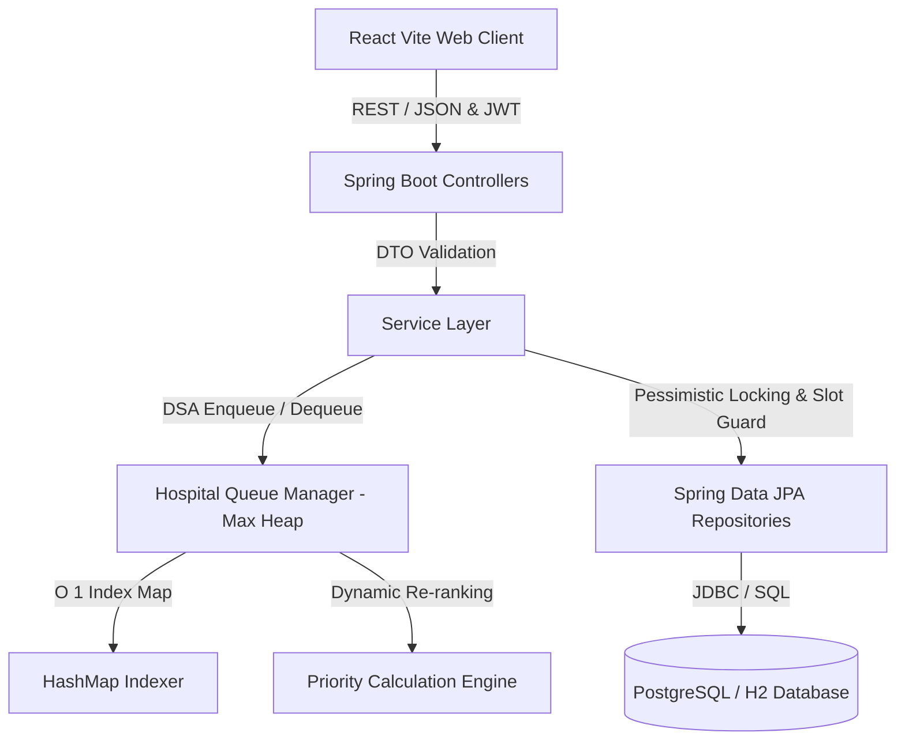

# System Architecture - Intelligent Hospital Queue & Appointment Optimization System

## Overview
The **Intelligent Hospital Queue & Appointment Optimization System** is a real-world enterprise full-stack platform designed to eliminate long patient waiting times, prevent doctor/department overload, dynamically prioritize high-severity emergency cases, and enforce fair queue progression.

---

## Key Architectural Principles

### 1. Separation of Concerns & Layered Architecture
- **Presentation Layer**: Controllers validate inputs using Bean Validation (`@Valid`) and return DTOs.
- **Service Layer**: Business logic for appointment scheduling, starvation prevention, doctor load balancing, and metrics calculation.
- **DSA Core Engine**: Dedicated `HospitalQueueManager` and `PriorityCalculationEngine` decoupled from standard database CRUD queries.
- **Persistence Layer**: Spring Data JPA repositories interfacing with PostgreSQL/H2 with custom pessimistic locks.

### 2. Transactional Concurrency Protection
- **Problem**: Simultaneous attempts by two patients to book the same doctor time slot.
- **Solution**:
  1. **Pessimistic Slot Locking**: `@Lock(LockModeType.PESSIMISTIC_WRITE)` executes `SELECT ... FOR UPDATE` on doctor schedules.
  2. **Database Unique Constraints**: `uk_doctor_schedule UNIQUE(doctor_id, appointment_date, time_slot)` acts as an immutable database-level fallback.
  3. **Isolation Level**: `SERIALIZABLE` isolation on slot bookings to eliminate phantom reads and dirty writes.

---

## Security Model
- **JWT (JSON Web Token)**: Stateless authentication via `JwtAuthenticationFilter`.
- **Role-Based Access Control (RBAC)**:
  - `ROLE_PATIENT`: Book appointments, join live queues, view personal queue ticket position.
  - `ROLE_DOCTOR`: Access doctor console, call next patient from heap, toggle availability status.
  - `ROLE_RECEPTIONIST`: Walk-in patient registration, triage priority assignment, queue monitor.
  - `ROLE_ADMIN`: Full system configuration, department congestion analytics, doctor utilization metrics.
